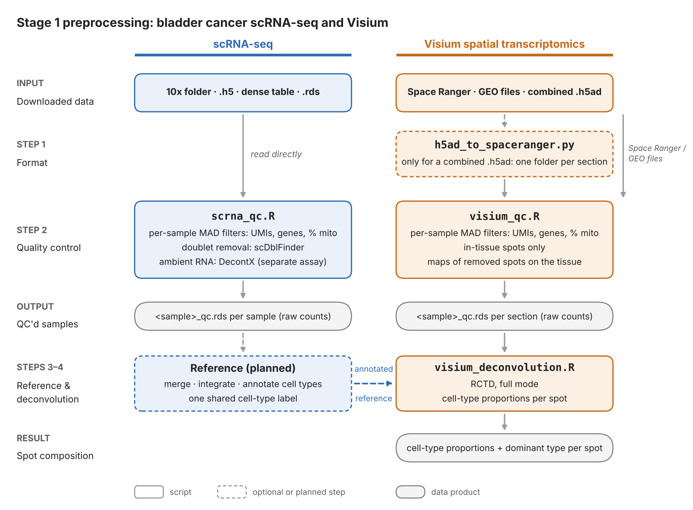

# 01 Preprocessing

Stage 1 takes each dataset from the form it was downloaded in to clean, per-sample Seurat objects that later stages can trust. For Visium, it also estimates the cell-type mixture of every spot. This page gives the overall plan and the approach. How each script works, and how to run it (algorithms, parameters, commands, outputs), is in the README next to it:

- [`scRNA/README.md`](scRNA/README.md): single-cell RNA-seq QC (`scrna_qc.R`)
- [`visium/README.md`](visium/README.md): Visium conversion, QC and deconvolution (`h5ad_to_spaceranger.py`, `visium_qc.R`, `visium_deconvolution.R`)

> Work in progress. Steps marked *planned* aren't in the repo yet.

---

## The pipeline at a glance



*Vector versions for slides and papers: [`figures/pipeline_overview.pdf`](figures/pipeline_overview.pdf) and [`.svg`](figures/pipeline_overview.svg). To edit the figure, change and rerun [`figures/make_pipeline_figure.py`](figures/make_pipeline_figure.py) (`python make_pipeline_figure.py`; needs matplotlib).*

**scRNA-seq** goes through QC (step 2). Its QC'd samples are then combined and annotated into the reference (step 3). That reference is what lets **Visium** spots be broken down into cell types (step 4).

---

## The shared QC method

`scrna_qc.R` and `visium_qc.R` run the same core algorithm. The only difference is the unit being judged: a **cell** for scRNA-seq, a **spot** for Visium. Each sample (one 10x capture or one Visium section) goes through these steps on its own.

### 1. Read and standardize

- **Check the sample sheet first.** Before any data is read, the script validates the dataset's sample sheet: paths exist, values have the right type, IDs are unique. Every problem is reported at once.
- **Convert to one format.** Whatever the input (10x folder, `.h5`, dense table, Space Ranger output, `.rds`), it becomes the same thing: a genes × units matrix of **raw counts**.
- **Make names safe.** Unit names get the sample ID as a prefix (`GSM3729178_AAACCTGAGATTACCC-1`), so they stay unique if samples are ever combined. Gene names are made Seurat-safe.

### 2. Measure every unit

| Metric | What it is | What a bad value means |
| --- | --- | --- |
| UMIs | RNA molecules captured | very low: broken cell or poorly captured spot |
| Genes detected | genes with at least one UMI | very low: same as above |
| % mitochondrial | share of UMIs from `MT-` genes | high: a dying cell, whose cytoplasmic RNA has leaked out while mitochondrial RNA stays trapped |
| % ribosomal, % hemoglobin | | recorded for later use, **never used to filter** |

### 3. Set cutoffs from the sample itself (MAD outlier detection)

The scripts don't apply one fixed rule (e.g. "at least 500 genes") to every dataset. Each metric is judged against the sample's own distribution. A unit is removed if it sits unusually far from the sample's typical unit, measured in **median absolute deviations (MADs)**:

$$\text{MAD} = 1.4826 \times \operatorname{median}\big(\lvert x_i - \operatorname{median}(x)\rvert\big)$$

| Metric | Scale | Flagged if | Default |
| --- | --- | --- | --- |
| UMIs, genes | log10 | below median − *n* × MAD | *n* = 3 |
| UMIs, genes | log10 | above median + *n* × MAD | *n* = 5 (lenient, so naturally large cells or RNA-rich spots aren't cut) |
| % mito | as is | above median + *n* × MAD | *n* = 3 |

- **Why the median and MAD:** a few extreme units barely move them. The mean and standard deviation, by contrast, get inflated by the very outliers they're meant to catch.
- **Why log10 for counts:** UMI and gene counts vary by multiples, and on a log scale their distribution is roughly symmetric.
- **Why per sample:** depth and quality differ between samples, and pooling them would judge one sample by another's distribution.

This follows the adaptive-threshold approach of the Bioconductor OSCA book, with the lenient upper cutoff favored by benchmarking (pipeComp).

### 4. Apply safety rails

The MAD cutoffs are bounded so that one unusual sample can't produce a nonsensical cutoff:

- **Hard floors:** a unit always needs a minimum number of UMIs and genes (the values differ by data type; see the table below). They protect a sample where most units are poor, whose median would otherwise be low.
- **Mito clamp:** the mito cutoff is kept between 10% and 25%. A very clean sample can't get an over-strict cutoff, and a messy one can't get a meaningless one.
- **Optional hard caps** on UMIs and genes.

### 5. Flag and record

- **Every unit gets one `qc_reason`:** `pass`, or the first check it failed.
- **Nothing is discarded silently.** The per-unit metadata table keeps every unit, removed ones included, with its metrics and reason.
- **The cutoffs each sample actually got** are written to `qc_thresholds.csv`.

### 6. Save and report

- **Gene filter:** genes detected in fewer than 3 of a sample's kept units are dropped.
- **Saved object:** each sample is saved as its own `<sample_id>_qc.rds`, holding **raw counts**. QC never normalizes, merges or integrates; those come later.
- **Reports:** both scripts write `all_samples_summary.csv` (units kept and removed, by reason), `samplesheet_resolved.csv` (every parameter used, per sample) and plots that show the cutoffs on the data. Both scripts plot violins before and after QC, and UMIs vs genes coloured by reason.

### Principles behind the method

- **QC removes technical failures, not biology.** Broken or dying cells, doublets and damaged spots go. Cell types we aren't interested in are kept and handled at annotation.
- **Same defaults for every dataset.** A dataset that needs different settings gets them per sample in its sample sheet, where they're visible and recorded, rather than by editing a script.

### Where scRNA-seq and Visium differ

On top of the shared core, each script adds what its data type needs:

| | scRNA-seq | Visium |
| --- | --- | --- |
| Cell / spot filters | MAD on UMIs, genes, % mito (floors 500 UMIs / 200 genes; mito clamp 10–25%) | Same MAD rules (floors 250 UMIs / 200 genes; same clamp) |
| Doublets | scDblFinder, per sample | Not applicable: a spot holds several cells by design |
| Ambient RNA | DecontX, kept as a separate assay | Not applied |
| Extra check | Doublet-score cutoff recorded and plotted | Maps showing *where* removed spots are on the tissue, so real low-RNA regions (stroma, necrosis) aren't cut out |
| Cell-type composition | From annotation (step 3) | RCTD deconvolution against the annotated scRNA-seq reference (step 4) |

### The deconvolution reference (step 3, planned)

The reference for RCTD will be **one combined, consistently annotated object built from our bladder scRNA-seq datasets**:

- **Build it from the QC'd samples:** merge them, integrate across samples and datasets (e.g. Harmony), cluster, and assign one shared `celltype` column. Integration is used only to label cells; RCTD reads the raw counts.
- **Label at the resolution the project needs:** for example, CAF subtypes rather than just "Fibroblast", and malignant epithelium as a shared type rather than per-patient clusters. Each type needs at least 25 cells.
- **Test robustness:** compare against references that each leave one dataset out, and against the single-nucleus GSE169379 reference. Patterns that hold across references are trustworthy.

---

## Folder layout

```
01_preprocessing+metadata/
├── README.md                        this file: the plan
├── figures/
│   ├── make_pipeline_figure.py      draws the pipeline figure
│   └── pipeline_overview.png/.pdf/.svg
├── scRNA/
│   ├── scrna_qc.R
│   ├── samplesheet_template.csv
│   └── README.md                    scRNA QC: method, parameters, outputs
└── visium/
    ├── h5ad_to_spaceranger.py
    ├── visium_qc.R
    ├── visium_deconvolution.R
    ├── samplesheet_template_visium.csv
    └── README.md                    Visium: conversion, QC, deconvolution
```

The step-3 reference-building script will go here once it's written.
